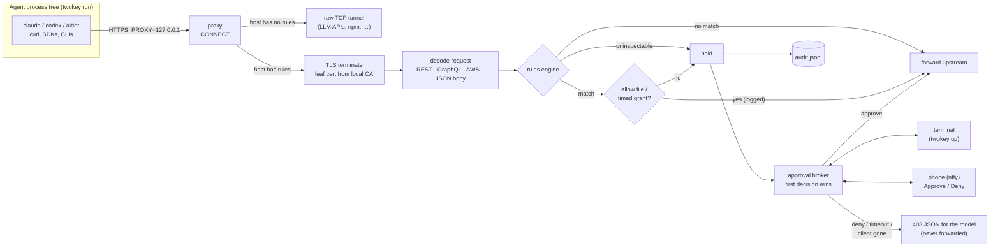

# Architecture

twokey is a single Go binary with no server component, no account and no telemetry. Everything
runs on the developer's machine and listens on loopback only.

## Request path

Database guards (`twokey pg`, `twokey mysql`) sit on a local port in front of the real database,
classify each statement (`internal/sqlclass`) and run the same hold step (`internal/sqlhold`)
through the same broker.

## Packages

| Package | Responsibility |
|---|---|
| `cmd/twokey` | CLI: `up`, `run`, `setup`, `pg`, `mysql`, `log`, `doctor`, `explain`, `replay`, `rules`, `ca`, `allow`, `uninstall` |
| `internal/proxy` | CONNECT handling, selective interception, request decoding, hold/forward, 403 responses |
| `internal/rules` | Embedded YAML rule packs, matcher engine (path templates, GraphQL, AWS, `json:`), allow rules, fixtures |
| `internal/approval` | Broker (first decision wins, timeout denies), terminal + ntfy channels, timed grants, desktop toasts, `Clean` |
| `internal/audit` | Append-only JSONL audit log |
| `internal/ca` | Name-constrained local CA, leaf minting, OS trust store add/remove by thumbprint, CA bundle, Java truststore |
| `internal/pgguard`, `internal/myguard` | Postgres / MySQL wire-protocol guards |
| `internal/sqlclass` | SQL lexer + classifier per dialect |
| `internal/sqlhold` | Shared hold + audit step for SQL |
| `internal/runenv` | Environment variables `twokey run` gives the agent |

## Security properties

- **Fail closed.** A request on a watched endpoint that twokey cannot decode (unknown encoding,
  persisted GraphQL query, malformed AWS form, unparseable SQL, opaque `DO`/`CALL`) is held.
- **Selective interception.** Only hosts named by rules are decrypted; everything else is a blind
  tunnel, so LLM API traffic and credentials for other services are never seen.
- **Name-constrained CA.** The root may only sign for the rule packs' domains and never for IP
  addresses; a leaked `ca-key.pem` cannot impersonate other sites. It rotates when rule domains grow.
- **Out-of-band approval.** Approvals arrive from the `twokey up` terminal or the phone; the ntfy
  topic is never in the agent's environment, and the project allow file is only used after the
  user trusts its exact content (`twokey allow trust`).
- **Untrusted text is defused.** Request-derived text shown to a human passes through
  `approval.Clean` (terminal escapes, bidi, zero-width and tag characters) and is never
  interpolated into scripts.
- **Bounded resources.** Bodies, headers, GraphQL expansion, SQL messages, pending holds and the
  audit log are all capped.

See [threat model](../README.md#threat-model--read-this) and [SECURITY.md](../SECURITY.md).

## Observability

twokey is a local tool, not a service, so it has no metrics endpoint. The observable surface is:

- `~/.twokey/audit.jsonl` (rotated) — every hold, decision, allow-list pass and observe-mode event;
  read with `twokey log` (`--denied`, `--provider`, `--since`, `--json`).
- `twokey doctor` — which runtimes on this machine are routed and trust the CA.
- `twokey.log` in `TWOKEY_HOME` for one-terminal phone mode.

## Release engineering

Tags `vX.Y.Z` trigger goreleaser: six platform builds (`CGO_ENABLED=0`, `-trimpath`, reproducible
timestamps), SBOM per archive, keyless cosign signature over `checksums.txt`, GitHub build
provenance attestations, then Homebrew cask + Scoop manifest. A smoke job installs every channel
and runs the binary; failures open an issue. CI runs vet, race tests on three OSes, e2e on three
OSes (real Postgres on Linux), gofmt, staticcheck, govulncheck, fuzzing, CodeQL and Scorecard.
